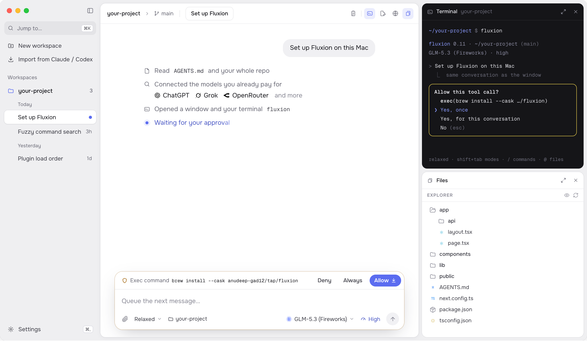

<p align="center">
  
</p>

<h1 align="center">Fluxion</h1>

<p align="center">
  <b>Pick up where you left off, with any model.</b><br>
  A coding agent for the models you choose, in a Mac window or your terminal.
</p>

<p align="center">
  <a href="https://fluxion.cc">fluxion.cc</a> ·
  <a href="https://github.com/anudeep-gad12/fluxion-releases/releases/latest">Latest release</a> ·
  <a href="https://fluxion.cc/privacy">Privacy</a>
</p>

## Install

```bash
brew install --cask anudeep-gad12/tap/fluxion
```

Or download `Fluxion-macos-arm64.dmg` from the [latest release](https://github.com/anudeep-gad12/fluxion-releases/releases/latest), open it, and drag Fluxion to Applications.

Fluxion needs a Mac with Apple Silicon on macOS 13.3 or later. It updates itself from this repo's releases.

## What it does

- **Switch models mid-conversation.** Sign in with ChatGPT or Grok, or add a key for OpenAI, xAI, OpenRouter, Fireworks or DeepInfra. The run, plan and context come with you.
- **Bring your Claude Code and Codex sessions.** Open them as Fluxion conversations, with their tool calls, output and edits, and keep going on any model.
- **Ask from any app.** Press <kbd>⌃</kbd><kbd>⌥</kbd><kbd>F</kbd> over whatever you're looking at, attach a screenshot and send.
- **Rewind or fork any prompt.** Try a message again, or branch a new conversation from it.
- **The same agent in your terminal.** Type `fluxion` in any project: same conversations, models and approvals.
- **See and approve every step.** Edits and commands wait for you unless you allow them, and read-only commands run in a macOS sandbox.

## Your data

Fluxion has no account and no server, and sends no analytics. Your conversations stay in `~/.fluxion`, keys stay in the macOS Keychain, and each run goes straight to the model provider you picked. Details are on the [privacy page](https://fluxion.cc/privacy).

## Feedback

Found a bug or want something? [Open an issue](https://github.com/anudeep-gad12/fluxion-releases/issues). Privacy questions go to privacy@fluxion.cc.
